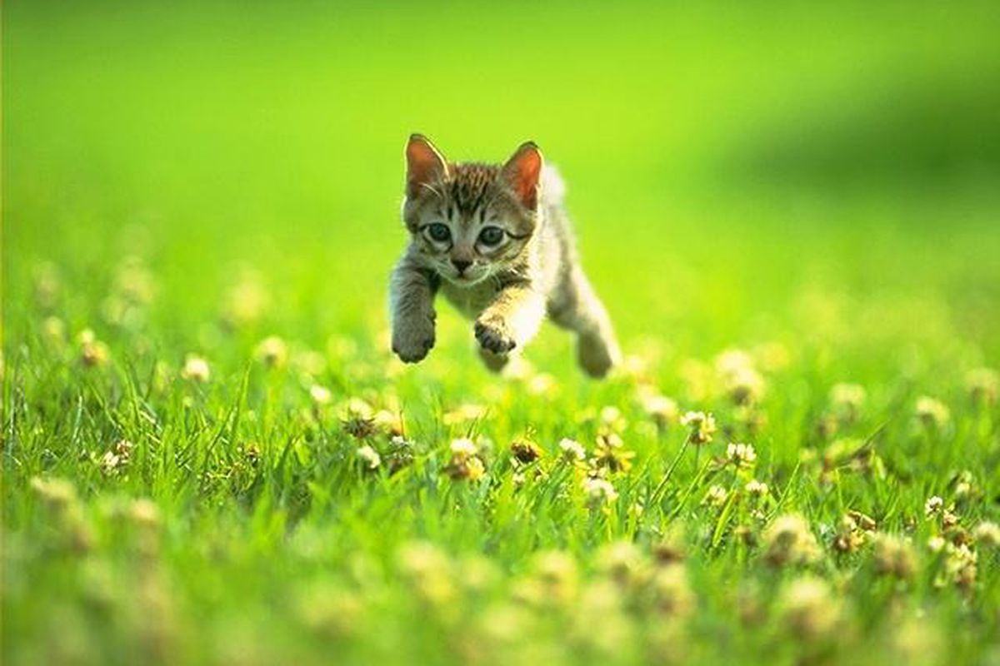

# Procesverslag
Markdown is een simpele manier om HTML te schrijven.  
Markdown cheat cheet: [Hulp bij het schrijven van Markdown](https://github.com/adam-p/markdown-here/wiki/Markdown-Cheatsheet).

Nb. De standaardstructuur en de spartaanse opmaak van de README.md zijn helemaal prima. Het gaat om de inhoud van je procesverslag. Besteedt de tijd voor pracht en praal aan je website.

Nb. Door *open* toe te voegen aan een *details* element kun je deze standaard open zetten. Fijn om dat steeds voor de relevante stuk(ken) te doen.

## Jij

  
uitwerken voor kick-off werkgroep

  ### Auteur:
  Rafi IJssel

  #### Je startniveau:
  Blauw

  #### Je focus:
  Responsive
 

## Je website

  
uitwerken voor kick-off werkgroep

  ### Je opdracht:
  Ik ga de website van joyridesweets namaken.
  

  #### Screenshot(s) van de eerste pagina (small screen): 
  De homepagina 
  
  

">

  #### Screenshot(s) van de tweede pagina (small screen):
  De product pagina
  
  
 
  
 

## Toegankelijkheidstest

  
De website was best toegankelijke werkgroep

  ### Bevindingen
  Lijst met je bevindingen die in de test naar voren kwamen:

  

  

  

  

  

## Voortgang 1 (week 2)

  
uitwerken voor 1e voortgang

  ### Stand van zaken
  hier dit ging goed & dit was lastig (neem ook screenshots op van delen van je website en code)

  ### Agenda voor meeting
  samen met je groepje opstellen

  | student 1      | student 2          | student 3    | student 4        |
  | ---            | ---                | ---          | ---              |
  | dit bespreken  | en dit             | en ik dit    | en dan ik dat    |
  | en dat ook nog | dit als er tijd is | nog een punt | dit wil ik zeker |
  | ...            | ...                | ...          | ...              |

  ### Verslag van meeting
  hier na afloop snel de uitkomsten van de meeting vastleggen

  - punt 1
  - punt 2
  - nog een punt
  - ...

## Voortgang 2 (week 3)

  
uitwerken voor 2e voortgang

  ### Stand van zaken
  hier dit ging goed & dit was lastig (neem ook screenshots op van delen van je website en code)

  ### Agenda voor meeting
  samen met je groepje opstellen

  | student 1      | student 2          | student 3    | student 4        |
  | ---            | ---                | ---          | ---              |
  | dit bespreken  | en dit             | en ik dit    | en dan ik dat    |
  | en dat ook nog | dit als er tijd is | nog een punt | dit wil ik zeker |
  | ...            | ...                | ...          | ...              |

  ### Verslag van meeting
  hier na afloop snel de uitkomsten van de meeting vastleggen

  - punt 1
  - punt 2
  - nog een punt
- ...

## Eindgesprek (week 4)

  
uitwerken voor eindgesprek

  ### Je uitkomst - karakteristiek screenshots:
  

  ### Dit ging goed/Heb ik geleerd: 
  Korte omschrijving met plaatjes

  

  ### Dit was lastig/Is niet gelukt:
  Korte omschrijving met plaatjes

  

## Herkansing

### Week 1
In de eerste week ben ik begonnen met het namaken van de JOYRIDE snoepwebsite voor een telefoonscherm.
- Kleuren opslaan: De felle, speelse kleuren van de originele site zijn geanalyseerd en vastgelegd in CSS custom properties, dit zorgt voor overzichtelijke en herbruikbare code.
- Lettertypes op mijn eigen computer zetten: Ik heb de lettertypes gedownload en in een fonts mapje gezet. Ik heb deze moeten downloaden omdat je niet google fonts zo mag inladen, dat gaat tegen een europese wet in. Ik heb Variable Fonts gebruikt: dat is één slim bestandje waarin alle diktes van de letters al zitten. Dat scheelt weer veel losse bestandjes!
- De voorkant bouwen: Ik heb alle blokken van de homepage onder elkaar gebouwd: het menu bovenin met het winkelmandje, het grote plaatje bovenaan, de snoepzakjes, de groene balk met winkels, het stukje over oprichter Ryan Trahan, de roze balk met reviews, de merch en helemaal onderaan de paarse footer.

### Week 2
In de tweede week heb ik ervoor gezorgd dat je echt door de plaatjes kunt klikken én dat de website er op een groot computerscherm ook goed uitziet.
- Werkende pijltjes met JavaScript: Op een telefoon passen niet alle snoepzakjes en reviews naast elkaar, dus staan ze in een slider met pijltjes
- Van klein naar groot scherm met @media: Met een @media regel in CSS heb ik ingesteld wat er gebeurt als je scherm groter is dan 1024 pixels

### Week 3
In de derde week heb ik de tweede pagina gemaakt en al mijn code flink opgeschoond.
- De productpagina: Als je op de homepage op de Cherry Berry Ropes klikt, ga je nu naar een nieuwe pagina.

## Bronnenlijst

  
continu bijhouden terwijl je werkt

  Nb. Wees specifiek ('css-tricks' als bron is bijv. niet specifiek genoeg). 
  Nb. ChatGpT en andere AI horen er ook bij.
  Nb. Vermeld de bronnen ook in je code.

  1. https://developer.mozilla.org/en-US/docs/Web/HTML/Reference/Elements/picture
  2. https://developer.mozilla.org/en-US/docs/Web/HTML/Reference/Elements/figure
  3. https://developer.mozilla.org/en-US/docs/Web/HTML/Reference/Elements/fieldset
  4. https://developer.mozilla.org/en-US/docs/Web/HTML/Element/output
  5. https://developer.mozilla.org/en-US/docs/Web/HTML/Element/menu
  6. https://developer.mozilla.org/en-US/docs/Web/CSS/Reference/Selectors/:only-of-type
  7. https://developer.mozilla.org/en-US/docs/Web/CSS/:nth-of-type
  8. https://css-tricks.com/snippets/css/a-guide-to-flexbox/
  9. https://css-tricks.com/snippets/css/complete-guide-grid/
  10. https://developer.mozilla.org/en-US/docs/Web/CSS/Using_CSS_custom_properties
  11. https://developer.mozilla.org/en-US/docs/Web/CSS/filter-function/drop-shadow
  12. https://developer.mozilla.org/en-US/docs/Web/API/EventTarget/addEventListener
  13. https://developer.mozilla.org/en-US/docs/Web/API/Element/classList
  14. https://gemini.google.com/app?hl=nl
  15. https://www.joyridesweets.com/
  16. https://fonts.google.com/specimen/Plus+Jakarta+Sans?preview.script=Latn
  17. https://fonts.google.com/specimen/Fredoka

